<p></p>

# UNIVAULT

### Don't ask for the document. Ask for the answer.


-2ea44f)

[](LICENSE)


**Live demo: [https://univault-zeta.vercel.app](https://univault-zeta.vercel.app)** (region Mumbai `bom1`).
Open [`/demo`](https://univault-zeta.vercel.app/demo) for the six-step guided demo, or
[`/features`](https://univault-zeta.vercel.app/features) for every feature and its honest status.

> Every organisation in the demo is **simulated**: no university, government office or employer is connected.
> The hashes and signatures are real cryptography. Sign-in and the one-time codes are simulated too.

---

## 1. The problem

Mahesh Mekhala has just graduated from VIT. Google wants to know whether he meets its hiring criteria. His
certificates come from VIT and from the Government Revenue Department. Today he would email PDFs of everything,
forever, with no idea who opened them, and Google would see far more than it needs.

## 2. The promise

1. **Prove you're ready.** Every document is checked against the issuer's signed record. Every purpose (job,
   scholarship, credential check) has a readiness checklist that says met, not met or unknown, with reasons.
2. **Share only what's needed.** A receiver can ask an *eligibility question* instead of asking for documents. The
   student allows each criterion one by one, and the receiver gets a signed met / not met / unknown answer and no document.
   When a document must be shared, the student sees exactly what the receiver will see before confirming.
3. **Take it back.** Each receiver gets its own watermarked link. The student can stop one link, one receiver or
   everything, then test that the link is really dead. Every attempt, allowed or denied, is in a tamper-evident ledger.

| Trust tier | Meaning | How it looks |
|---|---|---|
| **Issuer-verified** | Signature valid, and the fingerprint or fields match the issuer's registry | solid badge |
| **User-uploaded** | Stored, but not (yet) verified | outlined badge |
| **User-corrected** | Your correction, layered over the original with its provenance | dashed badge |

Tiers are **computed** from what happened (verification events and assertions), never declared by data.

## 3. The demo cast and the six steps

Who is in the demo is set in one file, [`src/config/demo-cast.json`](src/config/demo-cast.json). Change a name there
and the sign-in, the greeting and the issuer and receiver areas follow.

| Role | Who | What they do |
|---|---|---|
| **Issuer** | VIT University, Government Revenue Department | Sign and issue documents; can stop or replace them |
| **Sender** (the owner) | Mahesh Mekhala, student | Keeps documents, answers requests, shares only what is needed, stops sharing |
| **Receiver** | Google (`UV-R-2001`, purpose: job) | Asks the student an eligibility question, or asks for documents |

**The database starts empty.** Nothing appears until an issuer issues a document or the student uploads one.
Requests and alerts start at zero too; the student's bell fills only when Google sends a request or VIT issues
something. The guided demo at `/demo` ([`src/config/demo-guide.json`](src/config/demo-guide.json)):

1. **VIT issues a document** (sign in as Issuer → `/issuer/issue`).
2. **Mahesh checks it with the issuer** (Sender → `/verify`).
3. **Mahesh uploads a document of his own**, a PDF or a photo (Sender → `/add`).
4. **Google asks an eligibility question** (Receiver → `/receive/eligibility`).
5. **Mahesh answers it**, criterion by criterion (Sender → `/alerts`).
6. **Mahesh stops sharing** and tests the link (Sender → `/shares`).

## 4. What you see

| Sign-in | Home | Features |
|---|---|---|
|  | 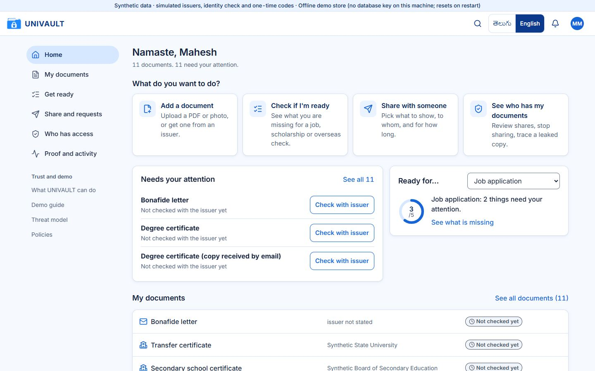 |  |
| **Demo guide** | **Get ready** | **Receiver** |
| 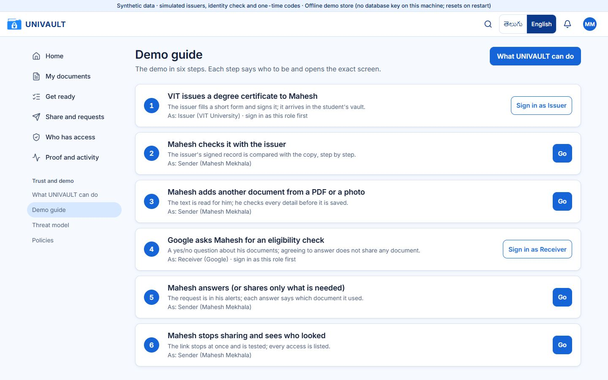 | 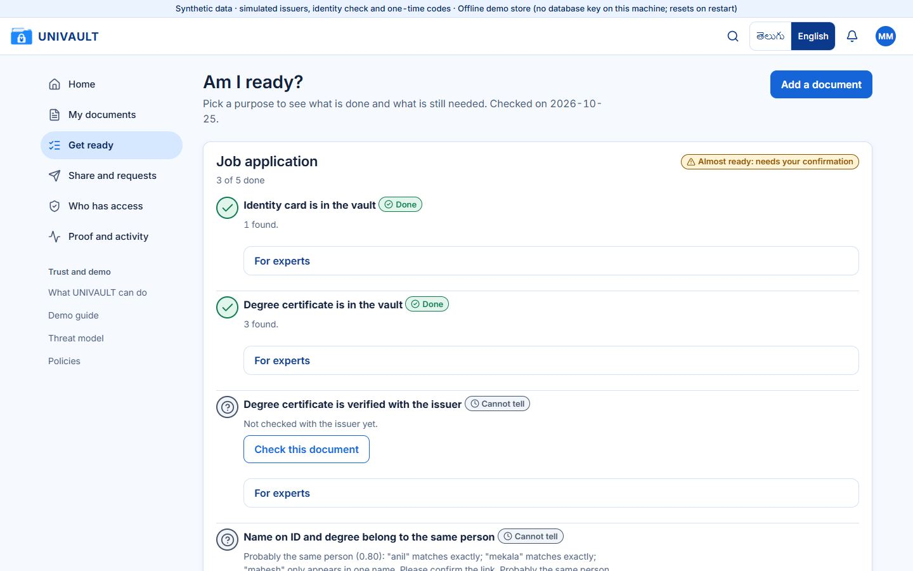 | 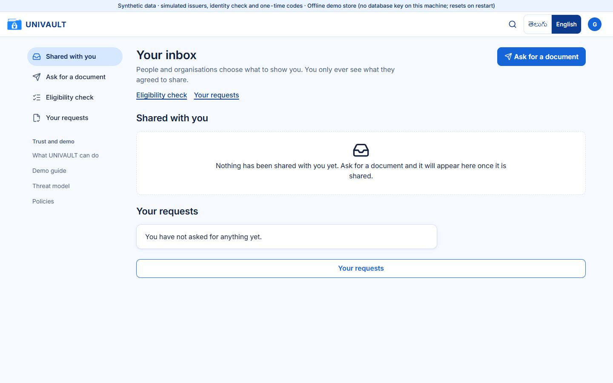 |

- **Sign-in:** a split screen. One list of three roles, "Signing in as Mahesh Mekhala", one Continue button, then
  a code and a consent step in the same panel with a step counter. Sign-in is **simulated**: the number is a
  synthetic Aadhaar-style number (it always starts 0000) and the code is shown on screen. No real Aadhaar or
  government service is used, and the number is masked after sign-in and never stored in full.
- **Home:** a greeting with real counts, four "What do you want to do?" tiles, "Needs your attention" (at most 3
  rows, one per document title, never repeated), one "Ready for…" card with a purpose picker, and the six newest
  documents. The full list with filters is at `/documents`.
- **Navigation:** the student's side menu has six entries (Home, My documents, Get ready, Share and requests, Who has
  access, Proof and activity); the issuer and receiver menus have four each. Settings, help, the tour, the demo guide,
  switching role and signing out are in the avatar menu.
- **Every page** starts with its title, one plain sentence saying what it is for, and one main button.
- **First-run tour:** four short steps (add, check, share, stop). It never blocks the page, Skip is remembered,
  and it can be reopened from the avatar menu.
- **Made for everyone:** English and Telugu throughout, Text size (A- / A / A+, 16 to 20 px), High contrast,
  keyboard-only use, and gentle motion that switches off for people who ask for less. Telugu was written by an AI
  model and is not yet reviewed by a native speaker: see [`docs/TELUGU_REVIEW.md`](docs/TELUGU_REVIEW.md).

All screenshots, before and after the latest redesign, at 1440, 768 and 390 px in English and Telugu, are in
[`docs/screenshots/phase11/`](docs/screenshots/phase11/).

### Feature screens

These were captured before the last two redesigns. The screens work the same way; only the look has changed.

| Vault: three tiers, immutable originals | Readiness per purpose |
|---|---|
| 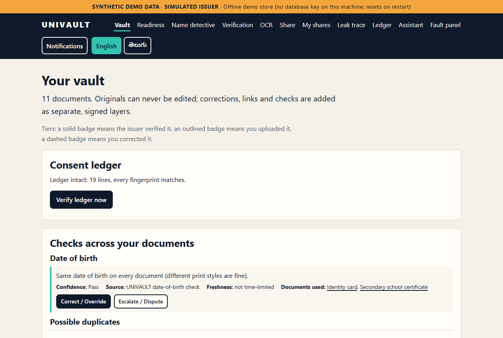 | 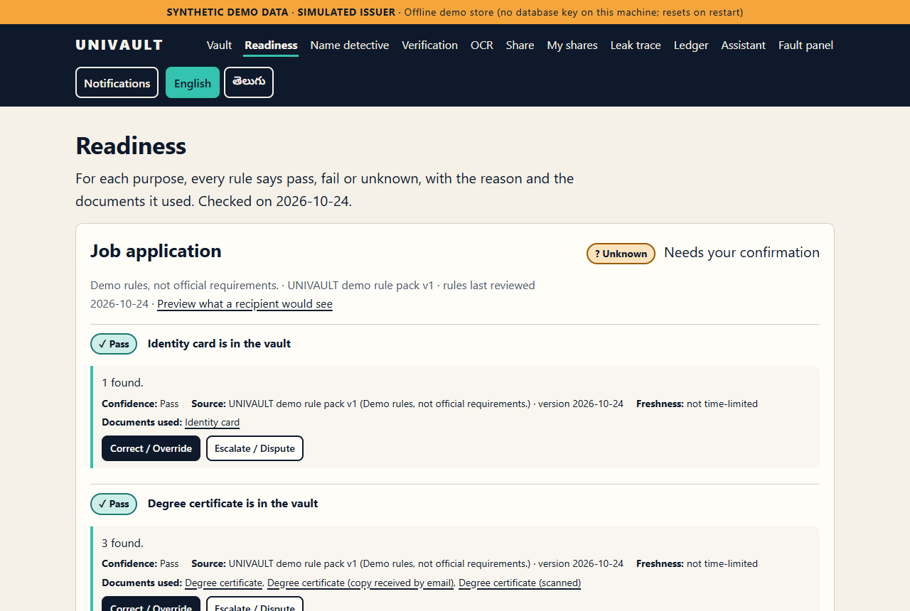 |
| **Name detective: ranked, never auto-merges** | **Verification: one altered digit, in neutral words** |
| 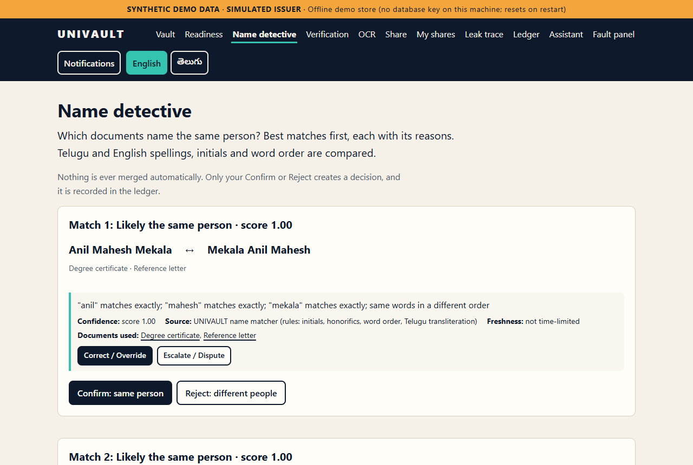 | 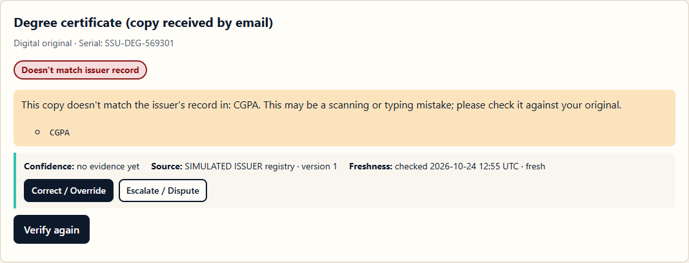 |
| **OCR: scan beside fields, confidence, corrections as layers** | **Share receipt: what was shared, with whom, until when** |
| 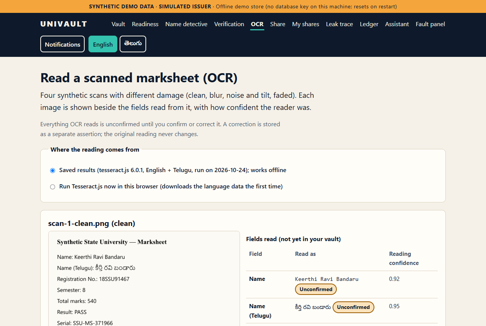 | 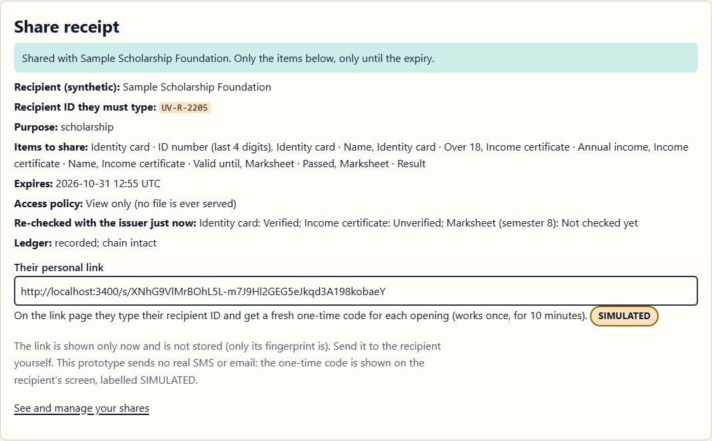 |
| **Recipient gate: ID + SIMULATED one-time code** | **Recipient view: minimal fields, diagonal watermark** |
| 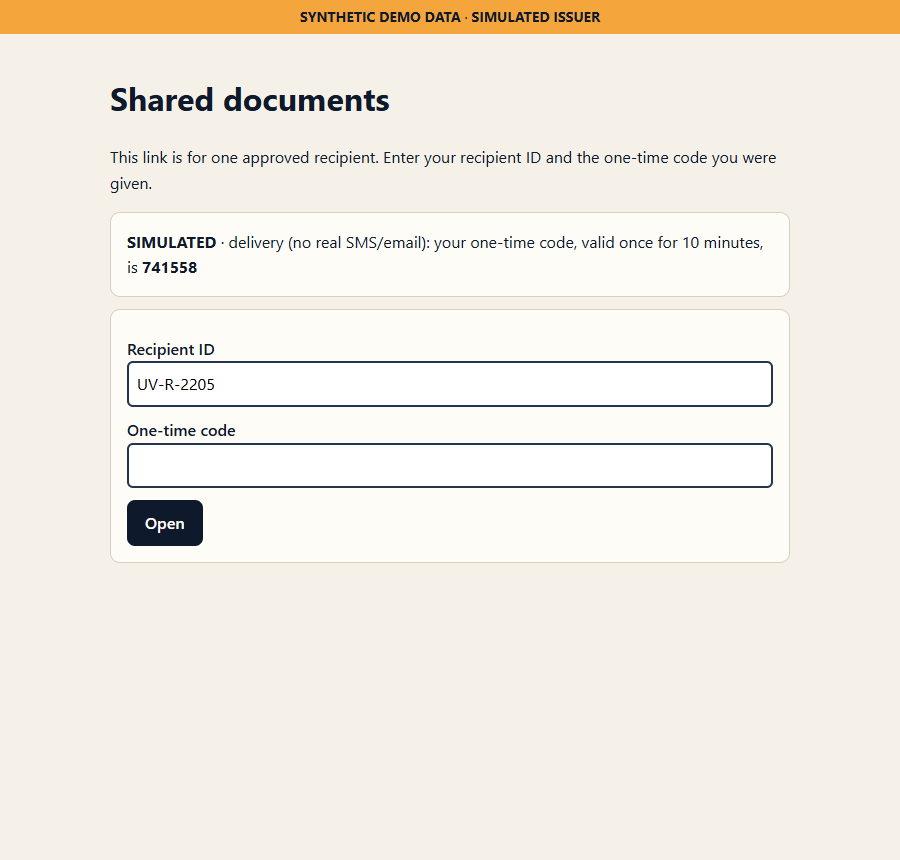 | 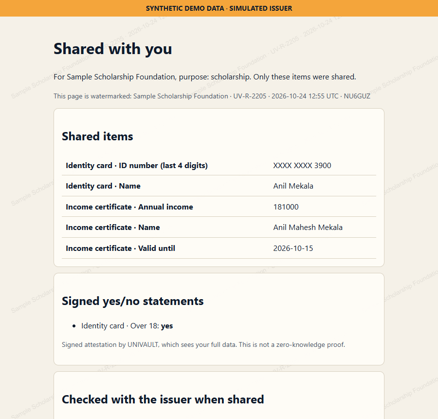 |
| **Leak trace: watermark text → recipient + session** | **Shares: access count, kill one link, test it** |
| 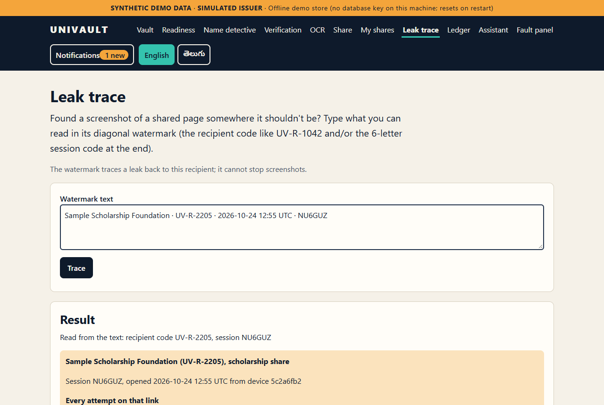 | 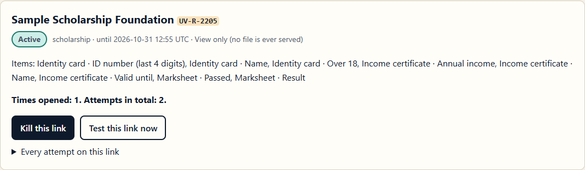 |
| **Fault panel: issuer timeout on, defined response** | **Ledger: verify the whole hash chain** |
| 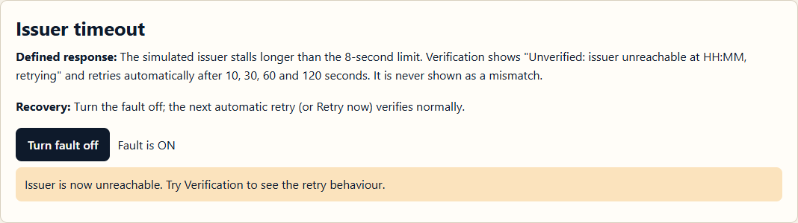 | 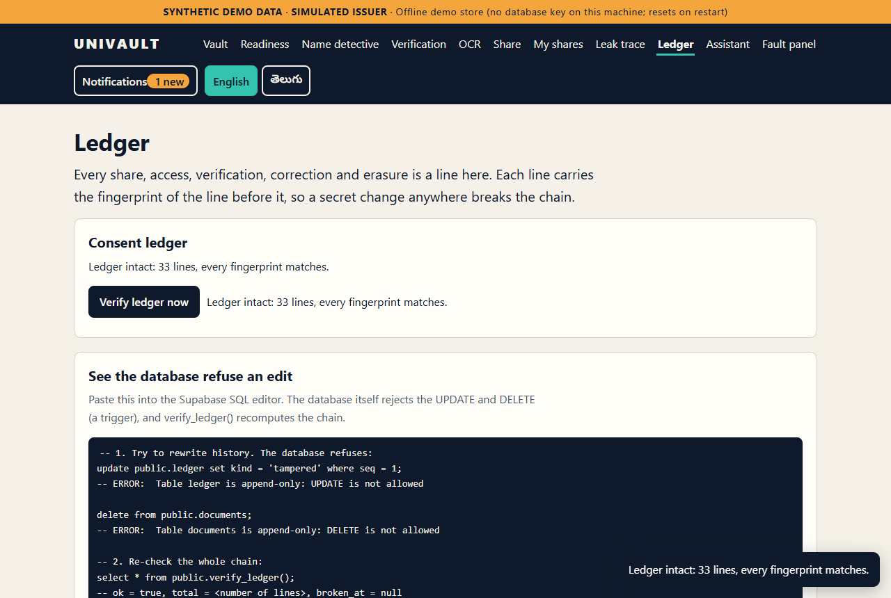 |

**How a share moves through its states** (each step is a separate append-only event plus a ledger line):

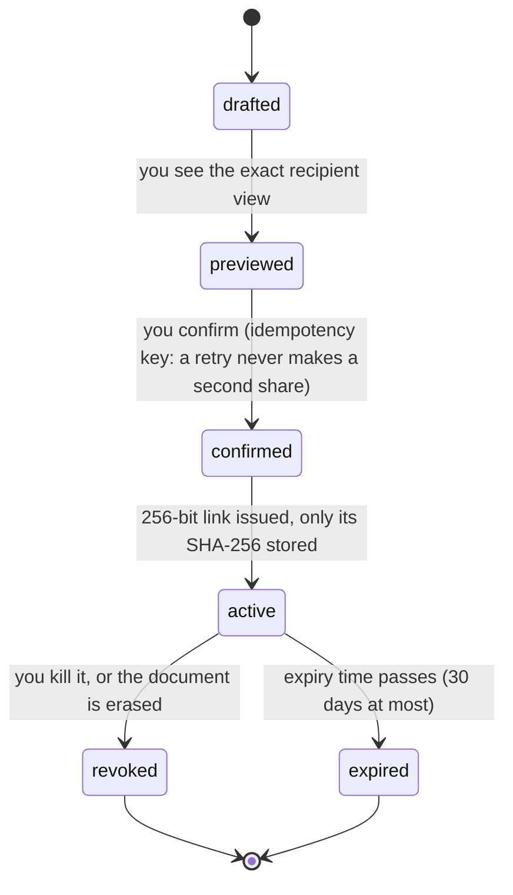

**What happens when a link is opened:**

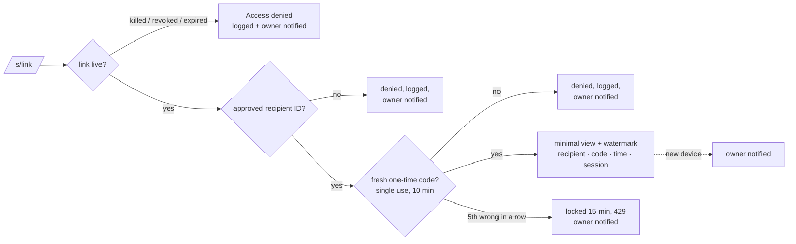

## 5. What it does, mapped to the brief

| Brief requirement | How UNIVAULT meets it | Where |
|---|---|---|
| Real documents in, originals kept | Upload a PDF (its text is read on the server) or a photo (read in the browser with OCR, shrunk to 1600 px). The original file is kept (up to 700 KB) and can be opened from the document page | `/add`, `src/lib/read-fields.ts`, `/api/upload/*` |
| ≥15 planted conflicts + data card | 17 planted conflicts in a generated showcase vault, plus 2 × 1,380 generated test documents (testing only; never loaded into the demo by default) | `synthetic/`, `docs/DATA_CARD.md` |
| Explicit state machines | Document, share and token states are separate; each transition is an event row plus a ledger line | `src/lib/shares.ts`, `share-store.ts` |
| Reason, confidence, source, freshness, override/escalate on every output | One shared `<Explain>` component on every automated result; overrides and disputes are append-only ledger lines | `src/components/Explain.tsx` |
| Survive injected faults | Issuer timeout, stale data, malformed upload, conflicting issuer update, connectivity loss, each with a defined response and recovery | `/faults`, `e2e/journey.e2e.ts` |
| Keyboard, screen reader, English + Telugu, low bandwidth | Skip link, visible focus, live region, Telugu for every screen, script-free recipient page | `e2e/` |
| Scripted tests with pass rate and precision/recall | 362 unit tests, 334 browser tests, evaluation harness on dev and held-out sets | `tests/`, `e2e/`, `eval/` |
| Tamper-evident audit log | Hash chain computed by a database trigger; `verify_ledger()`; edits and deletes refused (tested live) | `/ledger`, `docs/sql/001` |
| Declarative readiness, met/not met/unknown | Rule packs are JSON files; a new purpose needs no code | `src/rules/*.json`, `/readiness` |
| Eligibility answer instead of documents | The receiver asks; the student allows criteria one by one; missing, expired, conflicting or unverified evidence is always "unknown"; the signed answer says it is not proof and gives no document | `/receive/eligibility`, `/alerts` |
| Entity resolution that never auto-merges | Initials, word order, Telugu↔English spelling; ranked with reasons; Confirm/Reject only | `/names` |
| OCR with confidence, side-by-side view, corrections as assertions | Tesseract.js (eng+tel); the original reading is never changed | `/ocr` |
| Field-level selective disclosure + recipient preview | The exact recipient view before confirming; signed yes/no attestations ("over 18") | `/share` |
| Consent ledger with purpose, fields, recipient, expiry, access count | Every attempt (allowed or denied) goes to `access_log` **and** the ledger | `/shares`, `/ledger` |
| Verifiable revocation, with its limits stated | Stop one link, one receiver or everything, then "Test this link now"; "copies already downloaded can't be recalled" | `/shares` |
| Elite: per-recipient tokens and watermarks; trace and kill a leak | 256-bit links stored only as SHA-256; watermark shows recipient · code · time · session; leak trace | `/s/[token]`, `/leak-trace` |
| Elite: issuer re-check, notify, list affected shares | A scheduled server-side run once a day (Vercel Cron, protected by `CRON_SECRET`), plus "Re-check now" and a 60 s poll while `/shares` is open. Revoked, changed or expired → one alert per change; issuer down → "unknown", never failed | `src/lib/recheck.ts`, `/api/cron/recheck` |
| Brute-force resistance | 5 wrong codes in a row lock the link for 15 min (even against the right code) and alert the owner; 60 requests/min per address, 20 per link → 429 | `src/lib/rate-limit.ts`, `tests/lockout.test.ts` |
| Threat model and policy, backed by code | `/threat-model`: 14 threats, what stops each, what does not, and the code and test files behind it. `/policy`: what is stored, erased, kept and for how long | `/threat-model`, `/policy`, `tests/trust-pages.test.ts` |
| Curveball: one altered digit | Names the exact field: "doesn't match the issuer's record… may be a scanning or typing mistake" | `/verify` |
| Curveball: hidden text tells the assistant to share everything | The assistant only proposes and cannot share; the hidden text is flagged; ledger and share counts unchanged | `/assistant` |
| Curveball: over-broad request | Flagged, with a one-click minimal alternative | `/share` |
| Curveball: issuer down | "Unverified: issuer unreachable at HH:MM, retrying", retries at 10/30/60/120 s, never shown as a mismatch | `/verify` |
| OCR never authoritative | Unconfirmed OCR values can't pass a rule and are **withheld from shares** | `src/lib/disclosure.ts` |
| Nothing sensitive in links, URLs or logs | Log scrubber with tests; links carry only a random token; no analytics; telemetry off | `src/lib/scrub.ts` |
| Erasure and its limits | Limits shown first; content deleted; active shares revoked; fingerprint and times kept | document page → "Erase this document…" |

## 6. Architecture

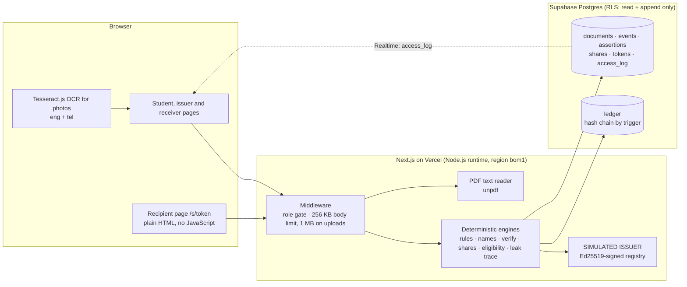

**The database enforces the rules, not just the app.**

- **Two layers stop edits.** Row-level security gives the app's public key no UPDATE or DELETE rights on any
  history table, so an edit or delete changes **0 rows** (tested against the live database on 13 tables). Behind
  that, a trigger refuses UPDATE and DELETE even for privileged roles (`Table ledger is append-only: UPDATE is not allowed`).
- **The chain is computed by the database.** The ledger works out each line's fingerprint, and the previous
  line's, in a BEFORE INSERT trigger. `verify_ledger()` re-checks the whole chain.
- **Two writes are allowed, by design:** deleting a document's *content* (that is how erasure works) and
  flipping the simulated issuer's on/off switch.
- **Forgery is caught.** Registry entries are signed, so a forged entry fails verification.
- **No AI model makes any decision.** Verification, readiness, eligibility, matching, sharing and revocation are
  deterministic code. OCR is the only machine-learning part, and its output stays *unconfirmed* until a person confirms it.
- **Roles are enforced on the server.** A signed (HMAC) session cookie carries the role; the middleware refuses
  another role's pages and APIs (for example, a receiver calling an issuer API gets 403).

## 7. Results

**Tests** (latest run, 2026-10-25). Browser tests run against an in-memory copy of the store
(`UNIVAULT_FORCE_OFFLINE=1`), so they never write to the demo database.

| Check | Result | Command |
|---|---|---|
| Unit, property, metamorphic, oracle, anti-hardcoding, wording and source-scan tests | **362 passed** (39 files) | `npm test` |
| Browser tests in Edge | Full run: **326 passed, 8 failed**. All 8 were axe checks on `/demo` (a button's spoken name didn't match its text); after the fix they pass on re-run, but the full suite has not been re-run since | `npx playwright test` |
| Accessibility (axe-core, WCAG 2.1 A/AA) | Every page in `e2e/a11y.e2e.ts`, for all three roles, in English and Telugu, normal, larger text and high contrast: **0** violations after the `/demo` fix | `e2e/a11y.e2e.ts` |
| Journey | upload → OCR fix → verify → readiness → confirm a name link → 2 shares → wrong ID, wrong code, right code → owner alert → trace watermark → kill one → kill all → ledger OK | `e2e/journey.e2e.ts` |
| Faults | each fault on → the screen says what happened → off → recovers | `e2e/journey.e2e.ts` |
| Lockout | 4 wrong codes → 403; 5th → 429 + Retry-After ≈ 15 min; the right code is then refused; owner gets "share_locked" | `e2e/share.e2e.ts` |
| Navigation and sign-in | role list by keyboard alone; Home has at most 3 attention rows, never the same title twice; every `/features` and `/demo` link opens a real page; the tour shows once and can be reopened | `e2e/phase11.e2e.ts` |
| Slow 3G (≈400 kbit/s, 2 s latency) | Student home **247 KB, 9.8 s** in English and **383 KB, 12.5 s** in Telugu. The target (169 KB, 7.2 s) is **not met**. The recipient page was 3.4 KB with 0 scripts when last measured | `e2e/slow3g.e2e.ts` |
| Dependencies | `npm audit`: 0 vulnerabilities (last run in Phase 6) | `npm audit` |

**Live database checks** (run on 2026-10-24, on the earlier test data)

| Check | Result | Command |
|---|---|---|
| Connectivity, ledger append, chain verify | all pass; `verify_ledger()` → `ok: true, broken_at: null` | `npm run db:check` |
| Tamper test with the app's key | UPDATE + DELETE tried on 13 history tables: all refused, every row unchanged, chain still verifies | `tests/live-db.test.ts` |
| Health | `{"ok":true,"db":"up"}` | `GET /api/health` |

**Detection on generated data** (`npm run eval`): 1,380 documents per set, 800 cases. Tuning used the dev
set only; the held-out set (seed 99) was not used for tuning.

| Category | Dev precision | Dev recall | Held-out precision | Held-out recall | False alarms (dev / held-out) |
|---|---|---|---|---|---|
| Names | 100% | 100% | 100% | 99.2% | 0 / 0 |
| Dates | 100% | 100% | 100% | 100% | 0 / 0 |
| Tampering | 100% | 100% | 100% | 100% | 0 / 0 |
| OCR review hints | 100% | 81.4% | 100% | 72.5% | 0 / 0 |
| Issuer state | 100% | 100% | 100% | 100% | 0 / 0 |
| Duplicates | 100% | 100% | 100% | 100% | 0 / 0 |
| Injection | 100% | 100% | 100% | 100% | 0 / 0 |
| Over-broad requests | 100% | 100% | 100% | 100% | 0 / 0 |
| Sharing (access, notifications, expiry, kill, revoke) | 100% | 100% | 100% | 100% | 0 / 0 |
| **All evaluated cases** | **100%** | **97.8%** | **100%** | **96.6%** | **0 / 0** |

Negative controls: 20 documents per set should raise no alarm, and none did.
**Showcase vault: 17 of 17 planted conflicts detected.**

**Where it fails (held-out, 20 misses):**

- **OCR, 19 misses:** digit confusion 4, heavy noise 4, mild blur 3, skew 3, low contrast 3, mixed script 1, Telugu conjuncts 1.
  These are misreads where Tesseract is confident and wrong: 10% of fields read with confidence ≥ 0.85
  were misread. That is why no OCR value counts until a person confirms it.
- **Names, 1 miss:** a name pair in Telugu script, scored 0.603 (below the "likely same" threshold).

## 8. Security

- **No secrets in git.** Only `.env.example` (names, no values) is tracked. Signing keys live only in local
  `.env.local` and in Vercel's environment settings.
- **Input validation.** Every API route and the recipient form validate input with Zod. Error replies name the
  field that was wrong, never its value.
- **Uploads.** Only PDF, JPEG and PNG are accepted, checked by their first bytes and not only their name, up to 700 KB.
- **Size limits.** A POST over 256 KB (1 MB on the upload routes) is refused (413) before any route reads it.
- **Slow-down.** Recipient pages allow 60 requests a minute per address and 20 per link (429 past that).
  Five wrong one-time codes in a row lock the link for 15 minutes and alert the owner.
- **Scheduled job.** `/api/cron/recheck` runs only with `Authorization: Bearer <CRON_SECRET>`, compared in
  constant time; without the variable set it refuses every call.
- **Headers.** Content-Security-Policy, `X-Frame-Options: DENY`, `Referrer-Policy: no-referrer` (share links
  contain a secret) and `X-Content-Type-Options: nosniff`.
- **Fails safe.** A production deploy without a database shows "Database not configured". It never falls back
  to a temporary in-memory store.
- **Logs.** All logging goes through a scrubber; there are no `console.log` calls with personal data.

## 9. Honest limits

- **Simulated organisations.** No real government, university, employer or DigiLocker connection.
- **The public database key can still read every table** until the owner adds a server-only key
  (`SUPABASE_SERVICE_ROLE_KEY`) and runs `docs/sql/004_lock_anon.sql`. Until then the vault is not private from
  someone who queries the database directly. `npx tsx scripts/anon-probe.ts` shows exactly what is readable.
- **Attestation, not zero-knowledge.** UNIVAULT sees your full data and signs statements like "over 18 = yes".
  The receiver trusts that signature and cannot check the fact independently.
- **Screenshots cannot be prevented.** The watermark only tells you *whose* screenshot it was.
- **Revocation can't recall copies.** Stopping a link stops access, but a downloaded copy stays downloaded.
- **A scanned PDF has no text to read.** The page says so; take a photo instead or type the details.
- **Uploads are small:** the original file is kept only up to 700 KB.
- **Rate limits are per server instance.** The per-minute counters live in memory, so on Vercel each instance
  counts on its own. The 15-minute lock after 5 wrong codes is stored in the database, so it holds everywhere.
- **OCR is unconfirmed** until you confirm it, and it can be confidently wrong (see the misses above).
- **The one-time code is shown on screen** (labelled SIMULATED) instead of being sent by SMS or email.
- **The scheduled issuer re-check runs once a day** (the most the Vercel Hobby plan allows). Nothing is revoked automatically.
- **Slow 3G target not met:** 247 KB and 9.8 s in English, 383 KB and 12.5 s in Telugu, against 169 KB and 7.2 s.
- **Not built, as `/features` also says:** checking a PDF that someone else sent you against the issuer's record,
  and the share wizard's preview-pages mode. Overrides and disputes are recorded but do not change decisions.
- **Telugu wording** has not been reviewed by a native speaker, and Telugu name matching was tuned on generated names.

## 10. Business

*All points below are hypotheses to test, not results.*

- **Who it's for:** (1) students and graduates applying to several places at once; (2) universities and
  government offices that issue documents; (3) employers and scholarship bodies that receive and check thousands
  of them each season; (4) overseas credential evaluators.
- **Go-to-market:** start with university placement cells. One institution onboards a whole graduating batch, and
  employers reached through student requests then adopt the receiver side.
- **Pricing:** free for individuals; per-check or per-seat for receiving organisations; an issuer-integration fee
  for institutions publishing signed registries.
- **Why now:** document requests are moving online faster than document *control* is.

## 11. Run it locally, or deploy

```bash
npm install
cp .env.example .env.local        # fill in the values (names in DEPLOY.md)
npm run dev                       # http://localhost:3000
```

```bash
npm run seed            # adds only the demo cast's receiver (Google); the vault starts empty
npm run seed -- --set showcase   # the old synthetic showcase dataset, for testing only
npm run db:check        # live database check: append, verify_ledger()
npm test                # unit tests
npm run eval            # precision/recall/false alarms on dev and held-out, plus the 17 showcase conflicts
npm run synth:all       # regenerate the synthetic test datasets (dev 7, held-out 99, showcase 2026)
npm run build && npx playwright test   # browser tests in Edge, on the in-memory store
```

Without a database key, or with `UNIVAULT_FORCE_OFFLINE=1`, the app uses an in-memory **offline store** with the
same append-only rules and hash chain. A production build refuses to do that. `GET /api/health` returns
`{ ok, db, time }` and nothing else.

**Emptying the demo database** is an owner-only step (the app's key cannot delete history): see
[DEPLOY.md](DEPLOY.md) section 4. **Deploying to Vercel:** also in [DEPLOY.md](DEPLOY.md).

## 12. Open-source credits

| Library | Version | Licence | Used for |
|---|---|---|---|
| Next.js | 15.5 | MIT | App framework |
| React / React DOM | 19 | MIT | UI |
| @supabase/supabase-js | 2 | MIT | Database client and Realtime |
| Zod | 4 | MIT | Input validation at every boundary |
| Tesseract.js (+ `eng`, `tel` tessdata) | 6.0 | Apache-2.0 | Reading text from photos |
| unpdf | 1.8.1 | MIT | Reading text from PDFs, on the server |
| lucide-react | 1.51 | ISC | The one icon set |
| motion | 13.5 | MIT | A few spring animations (loaded only on laptop-size screens) |
| Inter, JetBrains Mono, Noto Sans Telugu (via `next/font`) | — | SIL OFL 1.1 | English text, codes and IDs, Telugu text |
| sharp | 0.35 | Apache-2.0 | Rendering the synthetic scan images (dev only) |
| Vitest | 5 | MIT | Unit tests |
| Playwright (@playwright/test) | 1.64 | Apache-2.0 | Browser tests and screenshots |
| axe-core + @axe-core/playwright | 4.14 | MPL-2.0 | Accessibility checks |
| TypeScript, tsx | 6.0, 4 | Apache-2.0, MIT | Language and script runner |

Node's built-in `crypto` provides SHA-256, HMAC and Ed25519. There are no paid APIs, analytics or trackers.

**AI tools used: Claude** (Anthropic) was used as a coding assistant under the team's direction. The team
reviews, tests and can explain every part. **No AI model runs inside the product.**

## 13. Team

**Team SPACEX** · VIT-AP University · **IMPACTX 2026** · Challenge 02 "Your Documents, One Place"
