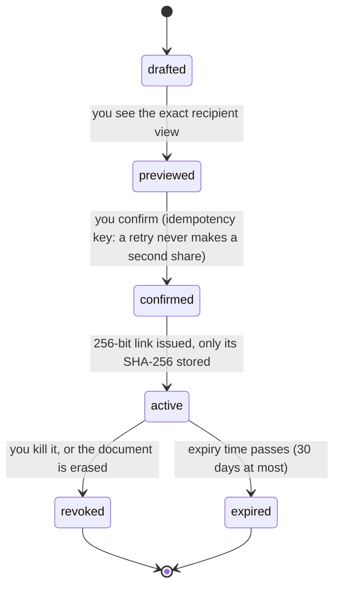
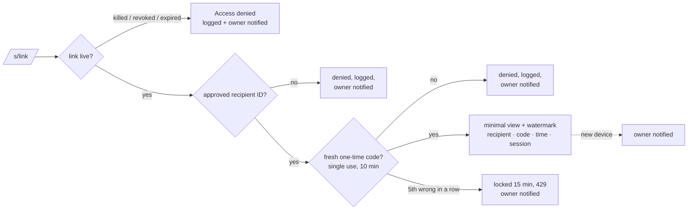
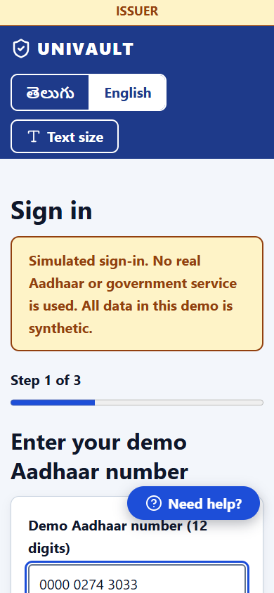
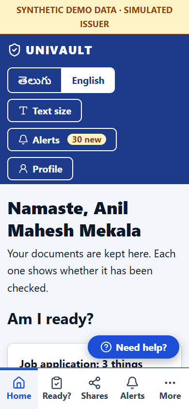
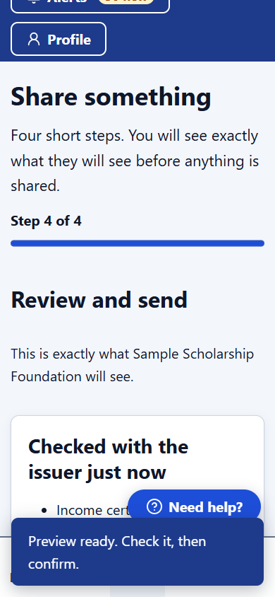
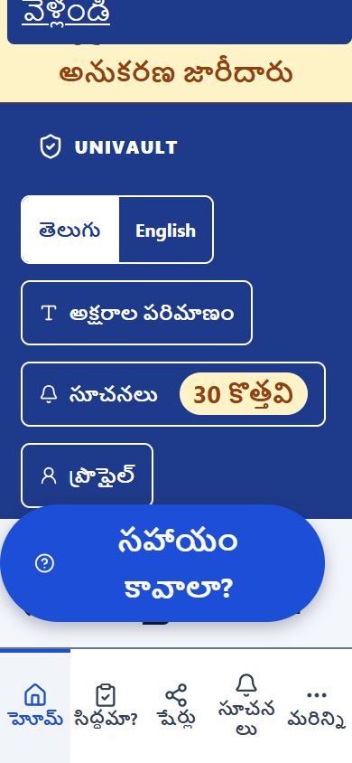
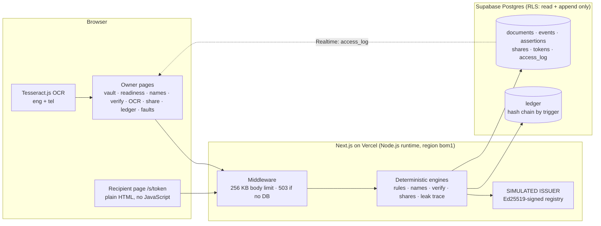

<p></p>

# UNIVAULT

### Prove you're ready. Share only what's needed. Take it back.


[](LICENSE)


**Live demo: [https://univault-zeta.vercel.app](https://univault-zeta.vercel.app)** (synthetic data only; region Mumbai `bom1`)

> Every person, document, issuer and recipient here is **synthetic**. The issuer is a **simulation**.
> The hashes and signatures are real cryptography, but no government or university system is connected.

---

## 1. The problem: a graduate's week

Anil has just graduated. In the same week he applies for a **job**, a **scholarship** and an
**overseas credential check**. His degree spells his name in full, but his ID card uses a shorter
form. His marksheet is a blurry scan in English and Telugu. His income certificate expired nine days
ago, and he didn't notice. One recipient asks for his full ID number when the last four digits would
do. Today he would email PDFs to everyone, forever, with no idea who opened them.

## 2. The promise

1. **Prove you're ready.** Every document is checked against a signed issuer record, and every
   purpose (job, scholarship, credential check) has a readiness checklist that says pass, fail or unknown, with reasons.
2. **Share only what's needed.** You see exactly what the recipient will see before you confirm.
   Over-broad requests are flagged, with a smaller alternative (the last 4 digits instead of the full ID number).
3. **Take it back.** Each recipient gets their own watermarked link. You can kill one link or all of them and test
   that it is really dead. Every attempt, allowed or denied, is in a tamper-evident ledger.

| Trust tier | Meaning | How it looks |
|---|---|---|
| **Issuer-verified** | Signature valid, and the fingerprint or fields match the issuer's registry | solid badge |
| **User-uploaded** | Stored, but not (yet) verified | outlined badge |
| **User-corrected** | Your correction, layered over the original with its provenance | dashed badge |

Tiers are **computed** from what happened (verification events and assertions), never declared by data.

## 3. Every feature, shown

Screenshots are captured from the running app by `npm run screenshots`, which clicks through it like a person would.

| Vault: three tiers, immutable originals | Readiness per purpose |
|---|---|
|  |  |
| **Name detective: ranked, never auto-merges** | **Verification: one altered digit, in neutral words** |
|  |  |
| **OCR: scan beside fields, confidence, corrections as layers** | **Share receipt: what was shared, with whom, until when** |
|  |  |
| **Recipient gate: ID + SIMULATED one-time code** | **Recipient view: minimal fields, diagonal watermark** |
|  |  |
| **Leak trace: watermark text → recipient + session** | **Shares: access count, kill one link, test it** |
|  |  |
| **Fault panel: issuer timeout on, defined response** | **Ledger: verify the whole hash chain** |
|  |  |

**How a share moves through its states** (each step is a separate append-only event plus a ledger line):



**What happens when a link is opened:**



## Phase 7: made for everyone

A 70-year-old who has never used a vault app can use UNIVAULT alone, in Telugu or English, on a cheap phone: 20 px text, a Text size control (A-/A/A+), a High contrast switch, one main button per screen, plain words with the technical term under "For experts", a "Need help?" panel on every screen, and gentle motion that switches off for people who ask for less movement.

Sign-in is **simulated**: a synthetic Aadhaar-style number (always starts 0000, with a Verhoeff check digit), a code shown on screen, a consent screen. No real Aadhaar or government service is used, and the number is masked after sign-in and never stored in full. The sign-in lock counts per server instance.

| Sign-in | Home | Share wizard |
|---|---|---|
|  |  |  |

Telugu and large text:  All screens are in `docs/screenshots/` (1440 and 390 wide, English and Telugu, normal and A+). Telugu was written by an AI model and is not yet reviewed by a native speaker: see `docs/TELUGU_REVIEW.md`.

## Phase 8 and 9: three roles, and what is still open

**Three roles, one pipeline.** You sign in as one of the demo parties: an **Issuer** (a government office, a university or a board: it signs and issues documents, and can stop or replace them), a **Sender** (a person who keeps documents and shares only what is needed, and can stop sharing at three levels: one link, one recipient, or everything), or a **Receiver** (an organisation that asks for documents, opens what was shared with it, or asks an eligibility question). Sender and Receiver are the same kind of account shown in two modes. Every account has a permanent **UV-ID**; a UV-ID names an account, it does not prove who is at the keyboard. Account verification and the one-time codes are **simulated**.

**Eligibility check.** A requester asks about the criteria of its purpose. The person allows criteria one by one. The answer is met, not met or unknown for each (missing, expired, conflicting or unverified evidence is always unknown), signed by UNIVAULT, says it is not proof, and gives no document.

**What Phase 9 closed** (each has a regression test; list in `docs/GAP_AUDIT.md`): per-field random salts and canonical values in the issuer registry, a PDF-only upload check, forwarded links refused for a different account (the log names both IDs), the route and role matrix, confirmation tied to the preview, source scans for logging and wording, and issuer authority by document type.

**What is not done, said plainly**
- **The public database key can still read every table** until the owner adds a server-only key (`SUPABASE_SERVICE_ROLE_KEY`) and runs `docs/sql/004_lock_anon.sql`. Until then the vault is not private from someone who queries the database directly. `npx tsx scripts/anon-probe.ts` shows exactly what is readable.
- Documents are structured details, not PDF files: there is no preview-pages mode, and a PDF is checked and refused or accepted at the door but not read into a document.
- The Slow 3G target (169 KB, 7.2 s) is not met: about 200 KB and 8.7 s.

## 4. What it does, mapped to the brief

| Brief requirement | How UNIVAULT meets it | Where |
|---|---|---|
| ≥15 planted conflicts + data card | 17 planted conflicts in a generated showcase vault, plus 2 × 1,380 generated test documents | `synthetic/`, `docs/DATA_CARD.md` |
| Explicit state machines | Document, share and token states are separate; each transition is an event row plus a ledger line | `src/lib/shares.ts`, `share-store.ts` |
| Reason, confidence, source, freshness, override/escalate on every output | One shared `<Explain>` component on every automated result; overrides and disputes are append-only ledger lines | `src/components/Explain.tsx` |
| Survive injected faults | Issuer timeout, stale data, malformed upload, conflicting issuer update, connectivity loss, each with a defined response and recovery, all tested on the live database | `/faults`, `e2e/journey.e2e.ts` |
| Keyboard, screen reader, English + Telugu, low bandwidth | Skip link, visible focus, live region, Telugu for the whole flow, script-free recipient page | `e2e/` |
| Scripted tests with pass rate and precision/recall | 183 unit tests, 37 browser tests, evaluation harness on dev and held-out sets | `tests/`, `e2e/`, `eval/` |
| Tamper-evident audit log | Hash chain computed by a database trigger; `verify_ledger()`; edits and deletes refused (tested live) | `/ledger`, `docs/sql/001` |
| Declarative readiness, pass/fail/unknown | Rule packs are JSON files; a new recipient needs no code | `src/rules/*.json`, `/readiness` |
| Entity resolution that never auto-merges | Initials, word order, Telugu↔Latin spelling; ranked with reasons; Confirm/Reject only | `/names` |
| OCR with confidence, side-by-side view, corrections as assertions | Tesseract.js (eng+tel), live or saved runs; the original reading is never changed | `/ocr` |
| Field-level selective disclosure + recipient preview | The exact recipient view before confirming; signed yes/no attestations ("over 18") | `/share` |
| Consent ledger with purpose, fields, recipient, expiry, access count | Every attempt (allowed or denied) goes to `access_log` **and** the ledger | `/shares`, `/ledger` |
| Verifiable revocation, with its limits stated | Kill one or all links, then "Test this link now"; "copies already downloaded can't be recalled" | `/shares` |
| Elite: per-recipient tokens and watermarks; trace and kill a leak | 256-bit links stored only as SHA-256; watermark shows recipient · code · time · session; leak trace | `/s/[token]`, `/leak-trace` |
| Elite: issuer re-check, notify, list affected shares | A scheduled server-side run once a day (Vercel Cron, protected by `CRON_SECRET`), plus "Re-check now" and a 60 s poll while `/shares` is open. Revoked, changed or expired → one alert per change; issuer down → "unknown", never failed | `src/lib/recheck.ts`, `/api/cron/recheck`, `tests/recheck.test.ts` |
| Brute-force resistance | 5 wrong codes in a row lock the link for 15 min (even against the right code) and alert the owner; 60 requests/min per address, 20 per link → 429 | `src/lib/rate-limit.ts`, `tests/lockout.test.ts` |
| Threat model and policy, backed by code | `/threat-model`: 14 threats, what stops each, what does not, and the code + test files behind it (a test checks every cited file exists). `/policy`: what is stored, erased, kept and for how long; numbers checked against the code | `/threat-model`, `/policy`, `tests/trust-pages.test.ts` |
| Curveball: one altered digit | Names the exact field: "doesn't match the issuer's record… may be a scanning or typing mistake" | `/verify` |
| Curveball: hidden text tells the assistant to share everything | The assistant only proposes and cannot share; the hidden text is flagged; ledger/share counts unchanged | `/assistant` |
| Curveball: over-broad request | Flagged, with a one-click minimal alternative | `/share` |
| Curveball: issuer down | "Unverified: issuer unreachable at HH:MM, retrying", retries at 10/30/60/120 s, never shown as a mismatch | `/verify` |
| OCR never authoritative | Unconfirmed OCR values can't pass a rule and are **withheld from shares** | `src/lib/disclosure.ts` |
| Nothing sensitive in links, URLs or logs | Log scrubber with tests; links carry only a random token; no analytics; telemetry off | `src/lib/scrub.ts` |
| Erasure and its limits | Limits shown first; content deleted; active shares revoked; fingerprint and times kept | vault → "Erase this document…" |

## 5. Architecture



**The database enforces the rules, not just the app.**

- **Two layers stop edits.** Row-level security gives the app's public key no UPDATE or DELETE rights on any
  history table, so an edit or delete changes **0 rows**. We tested this against the live database on 13
  tables. Behind that, a trigger refuses UPDATE and DELETE even for privileged roles
  (`Table ledger is append-only: UPDATE is not allowed`).
- **The chain is computed by the database.** The ledger works out each line's fingerprint, and the previous
  line's, in a BEFORE INSERT trigger. `verify_ledger()` re-checks the whole chain.
- **Two writes are allowed, by design:** deleting a document's *content* (that is how erasure works) and
  flipping the simulated issuer's on/off switch.
- **Forgery is caught.** Registry entries are signed, so a forged entry fails verification.
- **No AI model makes any decision.** Verification, readiness, matching, sharing and revocation are
  deterministic code. OCR is the only machine-learning part, and its output stays *unconfirmed* until a person confirms it.

## 6. Results

Every number below comes from a command run on 2026-10-24 against the **live Supabase database**, not the offline test store.

**Live database checks**

| Check | Result | Command |
|---|---|---|
| Connectivity, ledger append, chain verify, migration 003 | all pass; `verify_ledger()` → `ok: true, broken_at: null` (580 lines) | `npm run db:check` |
| Seed | 11 documents, 7 signed registry entries, 3 recipients; ledger intact | `npm run seed` |
| Tamper test with the app's key | UPDATE + DELETE tried on 13 history tables: all refused, every row unchanged, chain still verifies | `tests/live-db.test.ts` |
| Health | `{"ok":true,"db":"up"}` | `GET /api/health` |

**Detection on generated data** (`npm run eval`): 1,380 documents per set, 800 cases. Tuning used the dev
set only; the held-out set (seed 99) was not used for tuning.

| Category | Dev precision | Dev recall | Held-out precision | Held-out recall | False alarms (dev / held-out) |
|---|---|---|---|---|---|
| Names | 100% | 100% | 100% | 99.2% | 0 / 0 |
| Dates | 100% | 100% | 100% | 100% | 0 / 0 |
| Tampering | 100% | 100% | 100% | 100% | 0 / 0 |
| OCR review hints | 100% | 81.4% | 100% | 72.5% | 0 / 0 |
| Issuer state | 100% | 100% | 100% | 100% | 0 / 0 |
| Duplicates | 100% | 100% | 100% | 100% | 0 / 0 |
| Injection | 100% | 100% | 100% | 100% | 0 / 0 |
| Over-broad requests | 100% | 100% | 100% | 100% | 0 / 0 |
| Sharing (access, notifications, expiry, kill, revoke) | 100% | 100% | 100% | 100% | 0 / 0 |
| **All evaluated cases** | **100%** | **97.8%** | **100%** | **96.6%** | **0 / 0** |

Negative controls: 20 documents per set should raise no alarm, and none did.
**Showcase vault: 17 of 17 planted conflicts detected**, including the second-device open (#15) and the
wrong recipient ID followed by an attempt on a killed link (#16).

**Where it fails (held-out, 20 misses):**

- **OCR, 19 misses:** digit confusion 4, heavy noise 4, mild blur 3, skew 3, low contrast 3, mixed script 1, Telugu conjuncts 1.
  These are misreads where Tesseract is confident and wrong: 10% of fields read with confidence ≥ 0.85
  were misread. That is why no OCR value counts until a person confirms it.
- **Names, 1 miss:** a name pair in Telugu script, scored 0.603 (below the "likely same" threshold).

**Tests**

| Check | Result | Command |
|---|---|---|
| Unit, property, metamorphic, oracle, anti-hardcoding and live-DB tests | **183 passed** (20 files) | `npm test` |
| Browser tests in Edge, against the live database | **37 passed** | `npx playwright test` |
| Accessibility (axe-core, WCAG 2.1 A/AA) | 15 pages × English/Telugu = 30 runs: **0** critical, serious, moderate or minor | `docs/evidence/axe.json` |
| Manual-style journey | upload → OCR fix → verify → readiness → confirm a name link → 2 shares → wrong ID, wrong code, right code → owner alert → trace watermark → kill one → kill all → ledger OK: passed | `e2e/journey.e2e.ts` |
| Faults | each fault on → the UI says what happened → off → recovers (issuer timeout, stale, malformed, conflicting update, offline): passed | `e2e/journey.e2e.ts` |
| Share scenario | gate + watermark → second device → stranger denied + owner notified → leak trace → kill one → other works → erase: passed | `e2e/share.e2e.ts` |
| Lockout | 4 wrong codes → 403; 5th → 429 + Retry-After ≈ 15 min; the right code is then refused (429); owner gets "share_locked": passed | `e2e/share.e2e.ts` |
| Issuer re-check | revoked after sharing → 1 alert, not repeated; unchanged → none; issuer down → unknown, no alert: passed | `tests/recheck.test.ts` |
| Keyboard-only walk | vault → readiness → confirm a name link → correct an OCR field: passed | `e2e/keyboard.e2e.ts` |
| Slow 3G (≈400 kbit/s, 2 s latency) | recipient page **2.1 s, 3.4 KB, 0 scripts**. Vault page **7.2 s, 169 KB** to the load event, readable at **4.5 s** (first paint); before Phase 6: 12.0 s, 405 KB | `docs/evidence/slow3g.json` |
| Real OCR on the 4 generated scans | 22 of 28 fields read exactly before correction | `npm run ocr:fixtures` |
| Dependencies | `npm audit`: 0 vulnerabilities | `npm audit` |

## 7. Security

- **No secrets in git.** Only `.env.example` (names, no values) is tracked; we checked the repo and its full history.
  Signing keys live only in local `.env.local` and in Vercel's environment settings.
- **Input validation.** Every API route and the recipient form validate input with Zod. Error replies name the
  field that was wrong, never its value.
- **Size limits.** A POST over 256 KB is refused (413) before any route reads it.
- **Slow-down.** Recipient pages allow 60 requests a minute per address and 20 per link (429 past that).
  Five wrong one-time codes in a row lock the link for 15 minutes and alert the owner.
- **Scheduled job.** `/api/cron/recheck` runs only with `Authorization: Bearer <CRON_SECRET>`, compared in
  constant time; without the variable set it refuses every call.
- **Headers.** Content-Security-Policy, `X-Frame-Options: DENY`, `Referrer-Policy: no-referrer` (share links
  contain a secret) and `X-Content-Type-Options: nosniff`.
- **Fails safe.** A production deploy without a database shows "Database not configured". It never falls back
  to a temporary in-memory store.
- **Logs.** All logging goes through a scrubber; there are no `console.log` calls with personal data.

## 8. Honest limits

- **Simulated issuer.** No real government, university or DigiLocker connection.
- **Attestation, not zero-knowledge.** UNIVAULT sees your full data and signs statements like "over 18 = yes".
  The recipient trusts that signature and cannot check the fact independently.
- **Screenshots cannot be prevented.** The watermark only tells you *whose* screenshot it was.
- **Revocation can't recall copies.** Killing a link stops access, but a downloaded copy stays downloaded.
- **Demo-mode database key, no login.** One synthetic vault uses the public key. Row-level security limits that
  key to reading and appending, but anyone with it can append directly to the database (the app's rate limits
  do not apply to direct database calls).
- **Rate limits are per server instance.** The per-minute counters live in memory, so on Vercel each instance
  counts on its own and a cold start begins at zero. The 15-minute lock after 5 wrong codes is stored in the
  database, so it holds on every instance.
- **OCR is unconfirmed** until you confirm it, and it can be confidently wrong (see the misses above).
- **The one-time code is shown on screen** (labelled SIMULATED) instead of being sent by SMS or email.
- **The scheduled issuer re-check runs once a day** (the most the Vercel Hobby plan allows), so a change can
  go unnoticed for up to a day when nobody has `/shares` open. Nothing is revoked automatically.
- **The owner's vault page misses the 6-second Slow 3G goal**: 7.2 s to the load event (readable at 4.5 s).
  The React and Next.js runtime alone is about 102 KB. Telugu pages also need the 124.6 KB Noto Sans Telugu
  font on devices with no Telugu system font installed. The test machine has one (Nirmala UI), so the Telugu
  number in `slow3g.json` (7.2 s, 183 KB) does not include that font.
- **Not built:** overrides and disputes are recorded but do not change decisions; no real SMS/email delivery;
  no sign-in or per-user data separation.
- Telugu name matching was tuned on generated names. It is not a general transliteration engine.

## 9. Business

*All points below are hypotheses to test, not results.*

- **Who it's for:** (1) students and graduates applying to several programmes at once; (2) universities and
  scholarship bodies that receive and verify thousands of documents each season; (3) employers'
  background-verification teams; (4) overseas credential evaluators.
- **Go-to-market:** start with university placement cells and scholarship portals. One institution onboards a
  whole graduating batch, and recipients reached through student shares then adopt the verifier side.
- **Pricing:** free for individuals; per-verification or per-seat for receiving organisations; an
  issuer-integration fee for institutions publishing signed registries.
- **Why now:** document requests are moving online faster than document *control* is.

## 10. Run it locally, or deploy

```bash
npm install
cp .env.example .env.local        # fill in the values (names in DEPLOY.md)
npm run dev                       # http://localhost:3000
```

```bash
npm run synth:all       # regenerate the synthetic datasets (dev 7, held-out 99, showcase 2026)
npm run seed            # load the showcase vault into Supabase through ingestDocument()
npm run db:check        # live database check: append, verify_ledger(), migration 003
npm test                # unit, property, metamorphic, oracle, anti-hardcoding and live-DB tests
npm run eval            # precision/recall/false alarms on dev and held-out, plus the 17 showcase conflicts
npm run build && npx playwright test   # browser tests in Edge
```

Without a database key, `npm run dev` uses an in-memory **offline demo store** with the same append-only rules
and hash chain. A production build refuses to do that. `GET /api/health` returns `{ ok, db, time }` and nothing else.

**Deploying to Vercel:** see [DEPLOY.md](DEPLOY.md). It lists the env var names, where each value comes from, and the 5 clicks.

## 11. Open-source credits

| Library | Version | Licence | Used for |
|---|---|---|---|
| Next.js | 15.5 | MIT | App framework |
| React / React DOM | 19 | MIT | UI |
| @supabase/supabase-js | 2 | MIT | Database client and Realtime |
| Zod | 4 | MIT | Input validation at every boundary |
| Tesseract.js (+ `eng`, `tel` tessdata) | 6.0 | Apache-2.0 | OCR |
| lucide-react | 1.51 | ISC | The one icon set |
| motion | 13.5 | MIT | A few spring animations (loaded only on laptop-size screens) |
| Inter (via next/font) | - | SIL OFL | English text on laptop-size screens |
| Noto Sans Telugu (via `next/font`) | — | SIL OFL 1.1 | Telugu typeface |
| sharp | 0.35 | Apache-2.0 | Rendering the synthetic scan images (dev only) |
| Vitest | 5 | MIT | Unit tests |
| Playwright (@playwright/test) | 1.64 | Apache-2.0 | Browser tests and screenshots |
| axe-core + @axe-core/playwright | 4.14 | MPL-2.0 | Accessibility checks |
| TypeScript, tsx | 6.0, 4 | Apache-2.0, MIT | Language and script runner |

Node's built-in `crypto` provides SHA-256, HMAC and Ed25519. There are no paid APIs, analytics or trackers.

**AI tools used: Claude** (Anthropic) was used as a coding assistant under the team's direction. The team
reviews, tests and can explain every part. **No AI model runs inside the product.**

## 12. Team

**Team SPACEX** · VIT-AP University · **IMPACTX 2026** · Challenge 02 "Your Documents, One Place"
