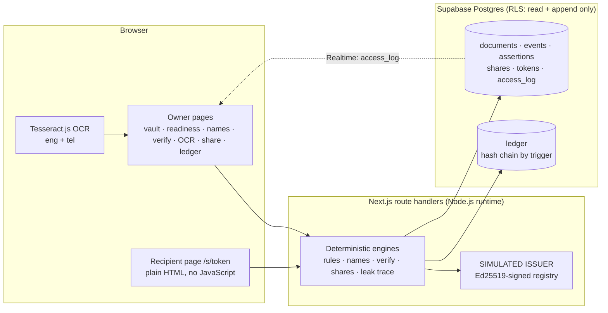

# UNIVAULT

### Prove you're ready. Share only what's needed. Take it back.


**[LIVE DEMO](#) — live demo link goes here**

> Every person, document, issuer and recipient here is **synthetic**. The issuer is a **simulation**.
> The hashes and signatures are real cryptography, but no government or university system is connected.

---

## 1. The problem: a graduate's week

Anil has just graduated. In the same week he applies for a **job**, a **scholarship** and an
**overseas credential check**. His degree spells his name in full, but his ID card uses a shorter
form. His marksheet is a blurry scan in English and Telugu. His income certificate expired nine days
ago, and he didn't notice. One recipient asks for his full ID number when the last four digits would
do. Today he would email PDFs to everyone, forever, with no idea who opened them.

## 2. The idea

UNIVAULT treats your **original documents as immutable evidence**. Every correction, name link, share,
revocation and erasure is a **separate, append-only layer** on top of them. Documents are checked
against a **signed issuer registry**. Each recipient gets **their own link**, which shows only what
the purpose needs, carries a watermark naming them, and can be **killed** without touching anyone else's.

| Trust tier | Meaning | How it looks |
|---|---|---|
| **Issuer-verified** | Signature valid, and the fingerprint or fields match the issuer's registry | solid badge |
| **User-uploaded** | Stored, but not (yet) verified | outlined badge |
| **User-corrected** | Your correction, layered over the original with its provenance | dashed badge |

Tiers are **computed** from what happened (verification events and assertions), never declared by data.

## 3. Screenshots

All of these were captured from the running app by `npm run screenshots`.

| Vault (three tiers, immutable originals) | Readiness per purpose |
|---|---|
|  |  |
| **Name detective (ranked, never auto-merges)** | **Verification: one altered digit, neutral wording** |
|  |  |
| **OCR: scan beside fields, confidence, accuracy before/after** | **Share receipt** |
|  |  |
| **Recipient view: minimal fields, diagonal watermark** | **Leak trace: watermark text → recipient + session** |
|  |  |
| **Ledger: verify the hash chain** | **Recipient gate: ID + SIMULATED one-time code** |
|  |  |

## 4. What it does, mapped to the brief

| Brief requirement | How UNIVAULT meets it | Where |
|---|---|---|
| ≥15 planted conflicts + data card | 17 planted conflicts in a generated showcase vault, plus 2 × 1,380 generated test documents | `synthetic/`, `docs/DATA_CARD.md` |
| Explicit state machines | Document, share (drafted → previewed → confirmed → active → revoked/expired) and token states are separate, and each transition is an event row plus a ledger line | `src/lib/shares.ts`, `share-store.ts` |
| Reason, confidence, source, freshness, override/escalate on every output | One shared `<Explain>` component on every automated result; override and dispute are append-only ledger lines | `src/components/Explain.tsx` |
| Survive injected faults | Fault panel covering issuer timeout, stale data, malformed upload, conflicting issuer update and connectivity loss, each with a defined response and recovery | `/faults` |
| Keyboard, screen reader, English + Telugu, low bandwidth | Skip link, visible focus, live region, Telugu for the whole flow, and a script-free recipient page | `e2e/` |
| Scripted tests with pass rate and precision/recall | 151 unit tests, 30 browser tests, and an evaluation harness on dev and held-out sets | `tests/`, `eval/` |
| Tamper-evident audit log | Hash-chained ledger computed by a database trigger; `verify_ledger()`; UPDATE and DELETE rejected | `/ledger`, `docs/sql/001` |
| Declarative readiness, pass/fail/unknown | Rule packs are JSON files; a new recipient needs no code | `src/rules/*.json`, `/readiness` |
| Entity resolution that never auto-merges | Handles initials, word order and Telugu↔Latin spelling; ranked with reasons; Confirm/Reject only | `/names` |
| OCR with confidence, side-by-side view, corrections as assertions | Tesseract.js (eng+tel), live or saved runs; the original reading is never changed | `/ocr` |
| Field-level selective disclosure + recipient preview | The exact recipient view before confirming; signed yes/no attestations ("over 18") | `/share` |
| Consent ledger with purpose, fields, recipient, expiry, access count | Every attempt (allowed or denied) is in `access_log` **and** the ledger | `/shares`, `/ledger` |
| Verifiable revocation, with its limits stated | Kill one or all links, then "Test this link now"; "copies already downloaded can't be recalled" | `/shares` |
| Elite: per-recipient tokens and watermarks; trace and kill a leak | 256-bit links stored only as SHA-256; watermark shows recipient · code · time · session; leak trace tool | `/s/[token]`, `/leak-trace` |
| Elite: issuer re-check, notify, list affected shares | "Re-check now" plus a 60 s poll; affected active shares listed; owner notified | `/shares` |
| Curveball: one altered digit | Names the exact field: "doesn't match the issuer's record… may be a scanning or typing mistake" | `/verify` |
| Curveball: hidden text tells the assistant to share everything | The assistant only proposes and cannot share; the hidden text is flagged and ledger/share counts are unchanged | `/assistant` |
| Curveball: over-broad request | Flagged, with a one-click minimal alternative (e.g. last 4 digits instead of the full ID) | `/share` |
| Curveball: issuer down | "Unverified: issuer unreachable at HH:MM, retrying", with retries at 10/30/60/120 s and "Retry now" | `/verify` |
| OCR never authoritative | Unconfirmed OCR values can't pass a rule and are **withheld from shares** | `src/lib/disclosure.ts` |
| Nothing sensitive in links, URLs or logs | Log scrubber with tests; links carry only a random token; no analytics; telemetry off | `src/lib/scrub.ts` |
| Erasure and its limits | Limits shown first; content deleted; active shares revoked; fingerprint and times kept | vault → "Erase this document…" |

## 5. Architecture



**The database enforces the rules, not just the app.** History tables reject UPDATE and DELETE with a
trigger (`Table ledger is append-only: UPDATE is not allowed`). The ledger computes its own
previous-line fingerprint and line fingerprint in a BEFORE INSERT trigger, and `verify_ledger()`
re-checks the whole chain. The only deletable table is the one holding document *content*, which is
how erasure works. Registry entries are signed, so a forged entry fails verification even though the
demo anon key can write to the table. No AI model makes any decision: verification, readiness,
matching, sharing and revocation are deterministic code. OCR is the only machine-learning component,
and its output stays *unconfirmed* until a person confirms it.

## 6. Results

Every number below is copied from a command that was run on 2026-10-24.

**Detection on generated data** (`npm run eval`): 1,380 documents per set, 800 cases. Tuning was done
on the dev set only; the held-out set (seed 99) was not used for tuning.

| Category | Dev precision | Dev recall | Held-out precision | Held-out recall | False alarms (dev / held-out) |
|---|---|---|---|---|---|
| Names | 100% | 100% | 100% | 99.2% | 0 / 0 |
| Dates | 100% | 100% | 100% | 100% | 0 / 0 |
| Tampering | 100% | 100% | 100% | 100% | 0 / 0 |
| OCR review hints | 100% | 81.4% | 100% | 72.5% | 0 / 0 |
| Issuer state | 100% | 100% | 100% | 100% | 0 / 0 |
| Duplicates | 100% | 100% | 100% | 100% | 0 / 0 |
| Injection | 100% | 100% | 100% | 100% | 0 / 0 |
| Over-broad requests | 100% | 100% | 100% | 100% | 0 / 0 |
| Sharing (access, notifications, expiry, kill, revoke) | 100% | 100% | 100% | 100% | 0 / 0 |
| **All evaluated cases** | **100%** | **97.8%** | **100%** | **96.6%** | **0 / 0** |

Negative controls: 20 documents per set that should raise no alarm, and 0 alarms were raised.

**Showcase vault: 17 of 17 planted conflicts detected** (`npm run eval`), including the second-device
open (#15) and the wrong recipient ID followed by an attempt on a killed link (#16).

| Check | Result | Command |
|---|---|---|
| Unit, property, metamorphic, oracle and anti-hardcoding tests | 151 passed, 1 to-do (16 files) | `npm test` |
| Browser tests (Edge) | 30 passed | `npm run e2e` |
| Accessibility (axe-core, WCAG 2.1 A/AA) | 13 pages × English/Telugu = 26 runs: **0** critical, 0 serious, 0 moderate, 0 minor | `npm run e2e` → `docs/evidence/axe.json` |
| Keyboard-only walk | vault → readiness → confirm a name link → correct an OCR field: passed | `e2e/keyboard.e2e.ts` |
| Phase 4 scenario | share → gate + watermark → second device → stranger denied + owner notified → leak trace → kill one link → other share works → ledger OK → erase: passed | `e2e/share.e2e.ts` |
| Slow 3G (≈400 kbit/s, 2 s latency) | recipient preview page: **2.1 s, 2.8 KB, 0 scripts**; full vault page: 10.4 s, 321 KB | `docs/evidence/slow3g.json` |
| Real OCR on the 4 generated scans | 22 of 28 fields read exactly before correction | `npm run ocr:fixtures` + OCR page |

**What is missed:** OCR review hints miss 13 of 70 misreads on dev and 19 of 69 on held-out. These are
plausible-looking misreads where Tesseract is confident and wrong. On the four real scans, `S` was
read as `5` with confidence 0.81. That is exactly why no OCR value counts until a person confirms it.
One held-out name pair in Telugu script is missed.

## 7. Honest limits

- **Simulated issuer.** No real government, university or DigiLocker connection.
- **Attestation, not zero-knowledge.** UNIVAULT sees your full data and signs statements like
  "over 18 = yes"; the recipient trusts that signature.
- **Revocation can't recall copies.** Killing a link stops access, but a downloaded copy stays downloaded.
- **Watermarks trace, they don't prevent.** A screenshot is still possible; the watermark says whose it was.
- **Demo-mode database key.** There is no real login. One synthetic vault uses the public anon key, and
  row-level security allows only read and append.
- **OCR is unconfirmed** until you confirm it, and the calibration table shows high-confidence misreads.
- **The one-time code is shown on screen** (labelled SIMULATED) instead of being sent by SMS or email.
- Telugu name matching was tuned on generated names. It is not a general transliteration engine.

## 8. Business

*All figures below are hypotheses to test, not results.*

- **Who it's for:** (1) students and graduates applying to several programmes at once; (2) universities
  and scholarship bodies that receive and verify thousands of documents each season; (3) employers'
  background-verification teams; (4) overseas credential evaluators.
- **Go-to-market (hypothesis):** start with university placement cells and scholarship portals. One
  institution onboards a whole graduating batch, and recipients reached through student shares then
  adopt the verifier side.
- **Pricing (hypotheses):** free for individuals; per-verification or per-seat pricing for receiving
  organisations; an issuer-integration fee for institutions publishing signed registries.
- **Why now (hypothesis):** document requests are moving online faster than document *control* is.
  Per-recipient, revocable, minimal sharing is the gap.

## 9. Run it locally

```bash
npm install
cp .env.example .env.local        # fill in the values
npm run dev                       # http://localhost:3000
```

Environment variables (names only; values never go in git):
`NEXT_PUBLIC_SUPABASE_URL`, `NEXT_PUBLIC_SUPABASE_ANON_KEY`, `ISSUER_PRIVATE_KEY`, `ISSUER_PUBLIC_KEY`,
`VAULT_PRIVATE_KEY`, `VAULT_PUBLIC_KEY`, `NEXT_TELEMETRY_DISABLED=1`. Generate the four Ed25519 keys
with the script in `UNIVAULT_SPEC.md` §12.

```bash
npm run synth:all       # regenerate the synthetic datasets (dev 7, held-out 99, showcase 2026)
npm run seed            # load the showcase vault into Supabase through ingestDocument()
npm run db:check        # schema and ledger sanity check
npm test                # unit, property, metamorphic, oracle and anti-hardcoding tests
npm run eval            # precision/recall/false alarms on dev and held-out, plus the 17 showcase conflicts
npm run build && npm run e2e   # browser tests in Edge: axe, keyboard, Telugu, Slow 3G, share scenario
```

Without a database key, `npm run dev` uses an in-memory **offline demo store** with the same
append-only rules and hash chain. A production build (`npm start`, Vercel) **refuses** to do that
and shows "Database not configured" instead; set `UNIVAULT_OFFLINE_DEMO=1` only for local tests.
`GET /api/health` returns `{ ok, db, time }` and nothing else.

## 10. Libraries and licences

| Library | Version | Licence | Used for |
|---|---|---|---|
| Next.js | 15.5 | MIT | App framework |
| React / React DOM | 19 | MIT | UI |
| @supabase/supabase-js | 2 | MIT | Database client and Realtime |
| Zod | 4 | MIT | Input validation at every boundary |
| Tesseract.js (+ `eng`, `tel` tessdata) | 6.0 | Apache-2.0 | OCR |
| Noto Sans Telugu (via `next/font`) | — | SIL OFL 1.1 | Telugu typeface |
| sharp | 0.35 | Apache-2.0 | Rendering the synthetic scan images (dev only) |
| Vitest | 5 | MIT | Unit tests |
| Playwright (@playwright/test) | 1.64 | Apache-2.0 | Browser tests and screenshots |
| axe-core + @axe-core/playwright | 4.14 | MPL-2.0 | Accessibility checks |
| TypeScript, tsx | 6.0, 4 | Apache-2.0, MIT | Language and script runner |

Node's built-in `crypto` provides SHA-256, HMAC and Ed25519. There are no paid APIs, analytics or trackers.

**AI tools used: Claude** (Anthropic) was used as a coding assistant under the team's direction. The
team reviews, tests and can explain every part. **No AI model runs inside the product.**

## 11. Team

**Team SPACEX** · VIT-AP University · **IMPACTX 2026** · Challenge 02 "Your Documents, One Place"
